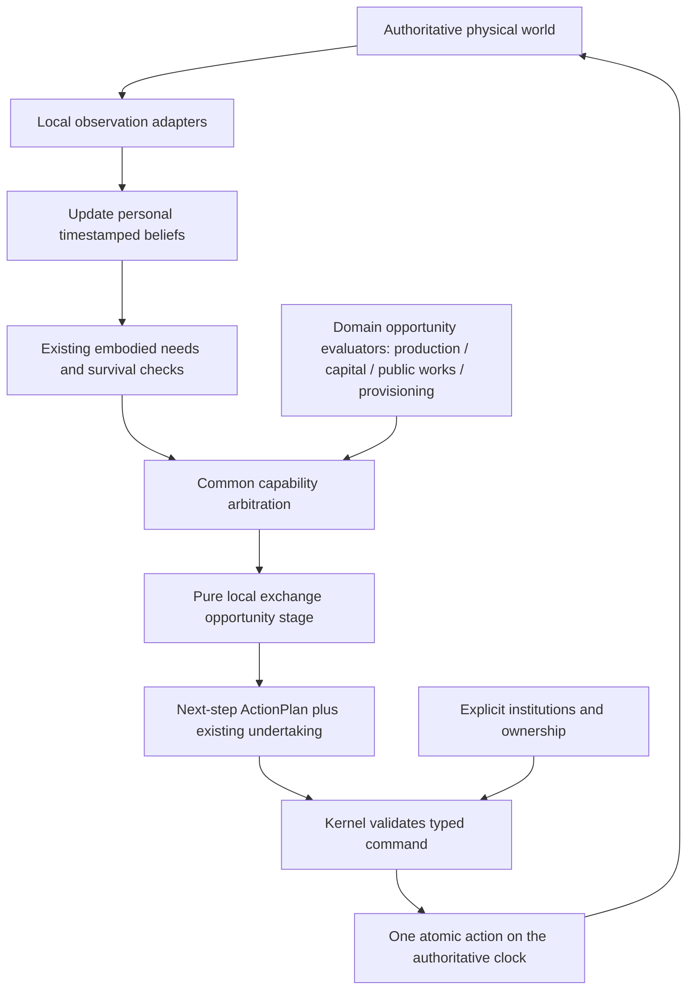

# B0: one embodied person, composable capabilities

The canonical architecture name is `Person`. It aliases the existing `Agent` record
rather than creating another entity or changing its historical debug/hash format.
A sovereign, cultivator, carrier, builder or trader has the same identity, body,
clock, private random stream and validated action executor.

## State and responsibility

| Concept | Existing authority / B0 interface | Information boundary |
|---|---|---|
| Identity, body, mortality | `Person` / existing `Agent`; location, nutrition, fatigue, starvation, action, death time | Own body; no privileged physiology for a role |
| Beliefs | `PolicyMemory` and timestamped farming/capital/infrastructure memory components | Personal observations; no refresh when inspected remotely |
| Needs | `person::Needs`, derived from current physiology | Existing 6h critical food, 12h self-provision preference and 22h fatigue thresholds; no new drive |
| Goals | Existing route goal plus the domain evaluators' conditional opportunities | No globally selected occupation or target |
| Intention / undertaking | Existing accepted `Job`, exposed through `reasoning::Undertaking` | Distinct from remote board lease; no stronger persistence |
| Current plan | `person::ActionPlan`: selected next command, reason, time, person and existing undertaking/route context | One execution step; not a fabricated committed multi-step plan |
| Atomic action | Existing `Action` finite-state executor | Travel, reservations, capacity, interruption and death validated by World |
| Roles | Own sovereign identity / own immutable steward appointment records | Not current remote office status; no role-dependent brain |
| Rights | Recognized communal membership, voluntary transfer, personal crop/cart institutions | Descriptive view; authoritative ownership/access checks still occur at execution |
| Possessions | Physical goods ledger, observed cargo and local/timestamped goods views | Ownership stays distinct from custody; no global inventory scan supplied to choice |
| Relationships, affect, life cycle | Deferred B1/B2/B3 components keyed by the same person IDs | Not represented by decorative zeros or implicit household sharing |

`World::person_state(id)` assembles a read-only view. It does not update memory,
choose a goal, settle an offer, declare a role, refresh remote truth or advance time.
A dead person's record remains inspectable but has no live observation or decisions.

## Behavioral path

The common `Context` accepts observation, spatial beliefs and available capability
components. It does not accept `World`, true territory, remote inventories or other
people's private needs. All people in a configured world may consider the existing
actions under their individual information and circumstances. There is no Farmer,
Builder, Merchant or Steward brain class.

The existing ordered policy remains an ordered policy. It checks food/survival,
fatigue, atomic work, public projects, capital, production, personal provisioning,
accepted jobs, exploration and waiting at the same places as before. No generic
utility sum replaces it; no random draw is moved to a new branch. Domain evaluators
continue to use bounded physical forecasts and explicit costs. Goals and next actions
can still be generated together by those existing evaluators; B0 does not claim to
have installed a general goal-search planner.

Barter selection is now pure. The observation adapter supplies local goods/offers
and the proposer’s locally inspectable escrow backing. Selection returns a command
and observational notes. World then applies the previous note deduplication,
research-only double-coincidence checks and event logs in exactly the same order.
Those diagnostics cannot feed a score, flag or hidden fact back into the selected
command. Escrow continues to affect usable goods and therefore existing valuation;
F9 posting/cancellation churn is preserved.

Historical diagnostic modes remain explicit adapters to the same person. Their
old precedence is retained: configured economic capabilities select coherent normal
mechanics; persistence/acceptance diagnostics apply in their original scenarios.
B0 does not adopt research-only meals, stronger commitments or different margins.

## Commands are not cognitive commitments

The older API name `Intent` means a **proposed atomic command**, including Eat,
Travel, Cultivate, ContributeCrossing, OfferBarter and AppointSteward. It does not
mean every such command becomes a persistent cognitive intention. `ActionPlan`
records the selected step, while `Job` retains the already accepted longer undertaking.
Candidate forecast tapes remain conditional on beliefs. No plan is made irreversible.

F10 appointments and initial commissions remain externally issued institutional
commands in the registered experiments. They pass through the same person executor
and law checks. There is still no autonomous political-recruitment policy. B0 makes
that absence explicit rather than inventing a role-specific decision system.

## Subsequent human milestones

B1 may add seeded household identities, kinship and explicit care proposals without
replacing members with a household super-agent. The exact care/sharing institution
must be registered separately; personal property does not silently become pooled.
No reproduction or inheritance is implied.

B2 may add directed relationship memory and event appraisal, with evidence that
changed history changes later choice. A new affect value must earn a causal use;
no decorative emotion fields. Observed support is distinct from expected support
and inferred intent, and neither permits remote social knowledge.

B3 may add causal age, fertility, pregnancy, birth, dependency and maturation.
Psychological differences must not be assigned as sex-based occupations or fixed
provider/nurturer stereotypes. Existing mortality and stable identity remain the
physical base. Population accounting and the accelerated provisioning physiology
will require an explicit experimental time-scale contract rather than an implicit
claim of realistic human biology.

F11 remains blocked until B0–B3 gates pass. None of B1–B3, military, culture bonuses,
new cooperation assumptions, money or additional player powers are implemented by B0.
