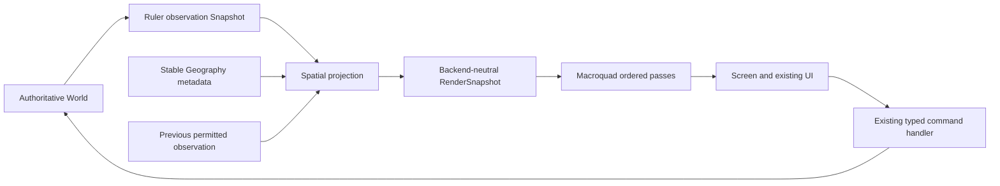

# W0 — world presentation engine

Macroquad remains the native backend. Rust and the headless kernel remain in
place. W0 is an internal presentation contract, not an engine migration, new
spatial simulation or promise of browser deployment.

## Data ownership

The renderer cannot issue commands or access World/Session. It receives permitted
observations. Play and Debug remain separate upstream views. The borrowed
`RenderSnapshot` is a frame contract, not a serialized save/network format; its
observation payloads are plain Rust data, with no renderer handles or resources.

`world_presentation.rs` owns Point, Geography, RouteGeometry, Region, Layer, LOD,
lighting/effect descriptions and pure projection. It imports no graphics API.
`scene.rs`, `spatial.rs` and `glyphs.rs` are the Macroquad backend. Existing chrome,
input, journal and typed command dispatch remain separate.

## Stable geography and regions

Geography holds continuous 2D node coordinates and optional per-route bend
metadata. Default coordinates preserve the existing scenario layout. Endpoint
order is canonical: reverse travel follows the same parametric curve. Route
width comes from the observed path stage. Endpoint coordinates and curve length
do not modify simulation edges, travel work, capacity, FIFO or contact.

Visible regions reference observed source IDs: institutional settlements,
cultivation units and finite wood deposits. Open ground is neutral presentation
background, not permission to traverse off-graph. Water has a typed region/pass,
but the current scenario has no water geography, so no water region is generated.
The crossing gap remains a schematic obstacle. A canopy symbol does not create
trees; a place symbol does not create buildings. See the existing
[visual-state contract](SPATIAL_PROJECTION.md).

## Pass order

1. Terrain/background and settlement clearing geometry.
2. Water, only when supplied by legitimate presentation geography; currently empty.
3. Fields and resource areas, with their actual known state.
4. Known routes and observed path wear.
5. Institutional place symbols and crossing construction/completion.
6. Persons, carts and observed unit groups. Persons use stable y/identity draw order.
7. Validated state-driven effect cues; W0 draws no particles.
8. Modest ambient lighting and optional radial emitter interface.
9. Selection and knowledge/label overlays, unaffected by the ambient wash.
10. Existing screen UI, composed by the caller last.

Selection hit geometry corresponds to these same projected objects. Labels are
queued for the overlay pass. There is no separate military scene or invented
continuous battlefield formation.

## LOD and motion

Zoom >= 0.95 draws simple figures; 0.5–0.95 uses compact individual markers; below
0.5 uses tiny individual markers. Persons retain IDs, hit records and evidence at
every LOD. There is no population aggregation or change to simulation update rate.
Far views hide labels and simplify places, fields and goods. Exact inspection
remains available. Thresholds are presentation parameters, not physical laws.

Two already executed permitted observations bound interpolation. On one edge,
the renderer interpolates authoritative traversal fraction and samples the curve;
it does not cut a straight chord through the landscape. Departure/arrival blend
within-node display packing into/out of the known endpoint. Those interpolated
positions never determine contact, travel progress or resource access.

Remembered records remain frozen. Reacquisition, unrelated route changes and
Play/Debug switches do not invent intermediate journeys. No extrapolation is
used. The existing fixed-step simulation retains backlog independently of frame
rate. Pause draws the current executed pose.

## Lighting and effects seam

The presentation clock maps authoritative elapsed time to a provisional 24-hour
solar cycle: T=0 is visual dawn. Ambient intensity is deliberately bounded
0.86–1.0 to preserve legibility. Simple Person ground shadows use the resulting
sun direction. This cycle changes neither knowledge nor NPC schedules, physics,
weather or visibility. It is not historical solar calibration.

Radial lights carry a source reference and cannot expose absent snapshot objects.
No emitter is created in this scenario: there are no torches/fires to justify one.
A future adapter must establish the actual light-producing state, not merely
that a Person exists. Expensive shadow maps/post-processing remain deferred.

Movement cues reference actual currently observed traveling Persons, position
and observation time. Rendering validates source/date/viewport before counting
them. Construction source/kind are reserved interfaces. No dust, fire, smoke,
rain or battle effects are spawned in W0. Future effects must inherit evidence
and cannot continue an unseen event merely because its old cue existed.

## Measurement and migration gate

The client records simulation CPU, observation capture CPU, projection CPU, draw
CPU, per-pass CPU, visible records, eligible effect cues, rendered effects, FPS and
process RSS. CPU measurements are not GPU completion time.

Pinned miniquad 0.4.11 has no functioning elapsed query: `get_result()` returns 0,
`is_available()` returns false and `is_supported()` is unimplemented. W0 therefore
reports GPU milliseconds as unavailable. It does not turn that 0 into a timing.

The legacy `last_draw_ms` measures full client frame composition, including
projection and UI. Render-pass CPU is separately available as `layer_cpu_ms`;
projection is `projection_cpu_ms`. The final UI pass is owned by the caller and
is a no-op in the world-backend array, not a measured zero-cost UI.

Macroquad's on-demand draw-call telemetry is usable, but creates preview textures
for batches. The benchmark samples it separately after timed frames, in a fresh
process per case. Ordinary play does not pay that profiling overhead. Unsupported
or deliberately skipped metrics are null, not zero.

`world_render_probe` measures 1,000/10,000/50,000 synthetic render records at three
LODs. They exist only in a benchmark observation buffer and never enter World.
The real 18-Person scenario, population and hashes remain unchanged. This tests
presentation load, not 50,000-person cognition, simulation or discovery. Each
case is bounded by frame/time guards and emits its negative results. A controlled
`world_motion_probe` separately uses actual Persons and a typed unit Move order.

Do not migrate on a slow high-detail stress case alone. First distinguish CPU
projection/sorting/primitive construction, batch submission, GPU fill, capture
overhead and simulation cost. A wgpu proposal must preserve this RenderSnapshot
boundary and show that Macroquad prevents a required measured capability after
reasonable LOD/culling/batching. No such backend decision is taken in W0.

## Scope boundary

No new simulation system, engine framework, external asset pipeline, save/load,
browser deployment, Jev, economic behavior or player power is introduced. World
coordinates are presentation coordinates, not irreversible replacement of node
semantics. Wide-scale world streaming, cached projection, region editing,
continuous collision and advanced effects remain separate possible work.

Stop after screenshots/motion review. Mechanical tests cannot certify human
readability. [W0 evidence and limitations](../research/world-presentation/REPORT.md).
